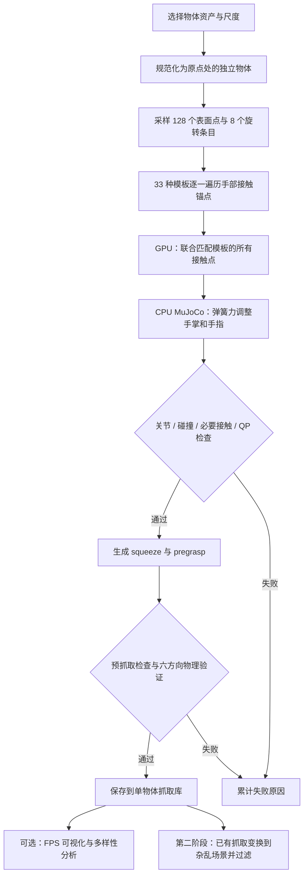

# 单物体多指抓取生成：完整流程、数学公式与优化目标

2026-11-12 整理后，五套最终数据实际位于 `output/datasets/`，旧候选和断点已删除。新的单物体生成任务默认写入 `work_runs/single_object_grasps_*`；旧批次不能续跑。本文的优化公式和生成算法不变，当前数据入口见 [最终数据说明](generated_data_zh.md)。

本文说明本仓库当前的 **Shadow 手单物体抓取生成流程**，适用于 GraspNet 和 DexGraspNet 两个入口。公式以现有实现为依据，分别说明直接求解的目标函数、用于理解仿真的能量模型，以及最终通过条件。

当前默认配置：**33 种模板、遍历全部 275 个手部接触锚点、128 个物体表面点、8 个旋转条目、1 轮采样、GPU 2 匹配、84 个 CPU 工作进程优化和验证**。实际运行配置保存在抓取库的 `runs/.../run_config.json`。

数学部分重点在第 5–9 节：依次说明 GPU 匹配损失、MuJoCo 弹簧力、QP 目标与约束、预抓取和夹持目标、动态验证判据。运行与进度在第 12 节，多样性公式在第 13 节。

## 1. 任务范围：两个独立阶段

第一阶段回答：**对于这个物体的这个尺寸，手可以从哪些位置、用哪些姿态稳定抓住它？**

物体位于原点，姿态为单位旋转，环境只有这一个物体和一只手。抓取按物体资产、尺度和类型保存，形成可复用的单物体抓取库。

第二阶段回答：**把已有抓取放进杂乱场景后，哪些抓取仍能执行？**

第二阶段读取第一阶段的库，将抓取变换到场景中物体的位姿，再检查桌面、邻近物体、接近路径等条件。换一个场景不要求重新生成该物体的单物体抓取。当前两个数据集入口执行第一阶段；杂乱场景流程见 [MuJoCo 杂乱场景文档](clutter_mujoco_zh.md)。



这里有两个不同的优化过程：GPU 的可微模板匹配，以及 CPU 的 MuJoCo 接触力调整。QP 求解和六方向扰动分别承担力平衡检查与动态验证。

## 2. 数学符号与手姿态表示

| 符号 | 含义 | 单位或维度 |
|---|---|---|
| $\mathcal M$ | 未施加配置尺度的物体表面网格 | 三角网格 |
| $S=\operatorname{diag}(s_x,s_y,s_z)$ | 物体配置中的尺度矩阵 | 无量纲 |
| $p_i,n_i$ | 第 $i$ 个物体表面采样点及法向 | 米、单位向量 |
| $T_H=(R_H,t_H)$ | 手掌相对物体的位姿 | $R_H\in SO(3)$，$t_H\in\mathbb R^3$ |
| $\theta$ | 手指关节角 | $\mathbb R^{22}$，弧度 |
| $h_k,m_k$ | 模板第 $k$ 个手部接触点及法向 | 米、单位向量 |
| $C_t$ | 第 $t$ 种模板的接触点数量 | 整数 |
| $P,R,E$ | 表面点数、旋转条目数、采样轮数 | 当前为 $128,8,1$ |
| $w=[f;\tau]$ | 六维接触力旋量：力与力矩 | 牛顿、牛顿米 |

一条 Shadow 手姿态的数组是：

$$
q_H=[t_x,t_y,t_z,\ q_w,q_x,q_y,q_z,\ \theta_1,\ldots,\theta_{22}]
\in\mathbb R^{29}.
$$

四元数顺序为 **`wxyz`**，单位四元数以 4 个数表示 3 个旋转自由度。因此 29 是存储维数，手掌与手指合计有 $6+22=28$ 个运动自由度。接触点数量与关节数量是两个不同概念：一个手部刚体可以标记多个接触点。

未缩放物体点到世界坐标的变换为：

$$
p^w=R_O S p^o+t_O.
$$

当前单物体生成时 $R_O=I,t_O=0$。GraspNet 保留米制实际尺寸，$S=I$；DGN 使用资产中已有的 6 个尺度。当前两套配置采用各轴一致的尺度。

## 3. 输入资产、固定保存位置与规范化

| 数据集 | 物体配置目录 | 当前本地资产数量 | 尺度 | 固定生成目录 |
|---|---|---|---|---|
| GraspNet-1Billion | `assets/object/graspnet_1billion/scene_cfg` | 88，编号 `000–087` | 原始尺寸 `[1,1,1]` | `output/single_object_grasps_graspnet_shadow` |
| DGN | `assets/object/DGN_5k/scene_cfg` | 5,697 | 每个物体 6 个原有尺度，共 34,182 个组合 | `output/single_object_grasps_dgn_shadow` |
| DexGraspNet 2.0 剩余 ShapeNet | `assets/object/dexgraspnet2_shapenet/scene_cfg` | 937 | 官方 `scaled.obj` 的米制尺寸，尺度 `[1,1,1]` | `output/single_object_grasps_dgn2_shapenet_shadow` |

上述 DGN 数量是当前本地资产包的配置数量。官方 Dexonomy 抓取单独保存在 `data/extracted/Dexonomy_GRASP_shadow/succ_collect`，新生成结果使用各自固定的输出库。

DexGraspNet 2.0 的“剩余物体”选择来自[官方数据包](https://huggingface.co/datasets/lhrlhr/DexGraspNet2.0) `acronym_test_scenes.tar.gz` 中 dense、random、loose 三类的 219 个物体标注，去重得到 **937 个物体 ID**：933 个 ShapeNet 哈希 ID，以及 `room04/room06/room11/room17` 这 4 个官方命名模型。这些物体均被官方标注为 `acronym`，不重复生成已有的 GraspNet `000–087`。论文提到 1,231 个 ShapeNet 物体，但这个公开版本的测试清单只有上述 937 个；模型包另有大量未出现在测试清单中的模型，不能据此猜测缺少的 ID。来源版本与两个官方压缩包的 SHA256 写入资产的 `import_manifest.json`。

官方 2.0 数据包附带的完整模型库可用 **DexGraspNet 2.0：下载附带模型库（7,985 个）** 启动项，或：

```bash
python scripts/prepare_dexgraspnet2_objects.py --full-release --download \
  --downloads downloads/dexgraspnet2_full_20261014
```

此模式枚举并解包官方 `acronym.tar.gz`、`meshdata.tar.gz` 的全部模型文件，不再按 937 个测试物体筛选。固定公开版本含 **7,897 个几何文件齐全的 ACRONYM 模型和 88 个 GraspNet 模型，共 7,985 个**；另外 5,572 个 ACRONYM 目录缺少 `scaled.obj` 等必需几何，原文件保留并单独列为不完整。完整数据在 `assets/object/dexgraspnet2_full`，`object_inventory.json` 给出可用几何清单，`incomplete_geometry.json` 给出缺失项。这个完整公开模型清单大于[论文项目页](https://pku-epic.github.io/DexGraspNet2.0/)报告的 1,319 个基准物体，不能将两者视为同一测试划分。完整包是原始模型；其中额外 ACRONYM 模型用于 MuJoCo 生成前仍需凸分解和资产转换。现有单物体生成入口继续使用已转换的 937 个物体。

严格按 DexGraspNet 2.0 基准范围核对时，[论文附录 C.1](https://arxiv.org/html/2410.23004v1#A3.SS1)报告 **88 + 1,231 = 1,319** 个物体。当前公开 219 个 ShapeNet 场景标注只确定 937 个唯一 ID，加上 88 个 GraspNet ID，得到 **1,025 个已确认物体**。`benchmark_inventory.json` 将这份清单与完整模型库分开，并记录 **294 个尚未确认的基准 ID**；这是 ID 对应关系未确认，不能推断这些网格文件必然缺失，也不能随意从附带模型库挑选 294 个充作官方基准。

这些模型使用官方仿真引用的 `scaled.obj`；同目录 `simplified.obj` 是未缩放的 ShapeNet 坐标，不能直接作为米制表面。导入器按 `scaled.obj` 生成 V-HACD 凸分解，再复用现有 MuJoCo 资产转换和逐模型编译验证。表面网格保持原文件坐标和字节，场景尺度设为 `[1,1,1]`。公开场景标注只用于选择物体 ID，其摆放姿态和其他障碍不参与单物体抓取生成。

[官方 Isaac Gym 加载器](https://github.com/PKU-EPIC/DexGraspNet2/blob/main/src/utils/simulator/isaacgym_simulator.py#L156-L165) 在运行时开启 V-HACD，分辨率为 100,000；公开 ShapeNet 包未提供导出的凸分解结果。当前 MuJoCo 导入使用环境已有的 `vhacdx`，分辨率 400,000、最多 64 个凸块、体积误差参数 1%，版本与参数记录在每个物体的 `import.json`。两种实现和参数不同，当前导出不是官方分解结果。V-HACD 偶尔产生零厚度平面凸块；导入器保留这些块并沿缺失维度添加总厚度 $10^{-6}$ 米，使 MuJoCo 可以计算碰撞，原表面采样网格保持不变。

首次准备资产可运行 **DexGraspNet 2.0：下载并接入剩余 ShapeNet 物体** 启动项，或：

```bash
python scripts/prepare_dexgraspnet2_objects.py --download --workers 24
```

每个物体需要表面网格、凸分解碰撞网格、MuJoCo XML，以及质量、体积和重心等信息。表面网格用于采样和最近点查询；凸分解网格用于 MuJoCo 碰撞计算。

GraspNet 资产导入入口为：

```bash
python scripts/prepare_graspnet_objects.py --download
```

[导入脚本](../scripts/prepare_graspnet_objects.py) 使用 DexGraspNet 2.0 官方模型包中的 `meshdata.tar.gz`，校验 SHA256，导入全部 88 个编号，复用 `coacd` 凸分解和 `simplified.obj`。导入保留 URDF 的固定连接、网格尺度及局部坐标，不重新运行凸分解。极小凸块保留碰撞几何，但可能不参与质量计算，处理记录位于 `assets/object/graspnet_1billion/import_manifest.json`。压缩包缓存于 `downloads/graspnet_1billion_meshdata.tar.gz`。

DGN 已处理资产在当前工作区已经就绪。新环境已有 `DGN_5k_processed.tar.gz` 时，可按 [数据准备文档](docker_visualization_zh.md) 使用 `python scripts/prepare_data.py --group processed` 解包。

[`canonical_object_scene`](../scripts/generate_single_object_grasps.py) 只保留目标物体和尺度，移除原配置的桌面、其他物体与摆放位姿，输出：

```text
物体位姿： [0, 0, 0, 1, 0, 0, 0]
任务类型： force_closure
配置位置： scene_cfg/<object>/floating/scale_<hash>.npy
```

`hash` 由物体 ID、资产的绝对路径和尺度联合生成，不只是尺度数字的哈希。相同资产位置、相同尺寸的物体在当前工作区复用同一身份；迁移资产路径可能改变身份。

## 4. 模板、接触锚点与候选组合

### 4.1 一个模板包含什么

每种模板提供初始手指角 $\theta_t$、手部接触点及法向 $\{h_k,m_k\}_{k=1}^{C_t}$、各接触点所属的手部刚体，以及必须参与接触的刚体分组 `required_cbody`。

例如 `24_Tip_Pinch` 有 2 个模板接触点。它们描述某种指尖捏取姿态的接触位置，不表示整个手只有两个关节。

模板位于 `assets/hand/shadow/init_tmpl/`。当前遍历以下 33 个原始模板，合计 **275 个接触点**：

| 模板 ID | $C_t$ | 模板 ID | $C_t$ |
|---|---:|---|---:|
| `1_Large_Diameter` | 16 | `18_Extensior_Type` | 7 |
| `2_Small_Diameter` | 15 | `19_Distal` | 10 |
| `3_Medium_Wrap` | 16 | `20_Writing_Tripod` | 4 |
| `4_Adducted_Thumb` | 11 | `21_Tripod_Variation` | 6 |
| `5_Light_Tool` | 13 | `22_Parallel_Extension` | 11 |
| `6_Prismatic_4_Finger` | 5 | `23_Adduction_Grip` | 4 |
| `7_Prismatic_3_Finger` | 4 | `24_Tip_Pinch` | 2 |
| `8_Prismatic_2_Finger` | 3 | `25_Lateral_Tripod` | 3 |
| `9_Palmar_Pinch` | 2 | `26_Sphere_4_Finger` | 15 |
| `10_Power_Disk` | 11 | `27_Quadpod` | 4 |
| `11_Power_Sphere` | 10 | `28_Sphere_3_Finger` | 12 |
| `12_Precision_Disk` | 7 | `29_Stick` | 13 |
| `13_Precision_Sphere` | 5 | `30_Palmar` | 15 |
| `14_Tripod` | 3 | `31_Ring` | 7 |
| `15_Fixed_Hook` | 16 | `32_Ventral` | 7 |
| `16_Lateral` | 2 | `33_Inferior_Pincer` | 4 |
| `17_Index_Finger_Extension` | 12 | **合计** | **275** |

### 4.2 128 个物体点如何与手接触点组合

[`sample_init_pose`](../dexonomy/data/obj_loader.py) 使用 `trimesh.sample.sample_surface_even` 在三角网格表面采样 $P$ 个点，数量不足时以普通表面采样补足。这一步是表面采样，不是抓取结果的 FPS。

对每个点使用朝向物体内部的法向 $n_i^{\rm in}$ 建立接触坐标系，令第一轴与它一致。绕这根轴生成旋转条目：

$$
\alpha_r=-\pi+\frac{2\pi r}{R-1},\qquad r=0,\ldots,R-1\quad(R>1),
$$

$$
R_{C,0}=B(n_i^{\rm in})R_x(\alpha_r),\qquad t_{C,0}=S p_i.
$$

其中 $B(n)$ 是由法向和两个切向构成的正交基。$R=1$ 时按代码的 `np.linspace` 只取一个条目。

接着，**每个手部接触点 $j$ 都轮流作为初始化锚点**。以该点为原点、该点法向为第一轴，把整套模板转换到锚点坐标系：

$$
c_k=B(m_j)^\top(h_k-h_j),\qquad
\bar m_k=B(m_j)^\top m_k.
$$

令锚点坐标系与物体采样坐标系重合，就得到初始整手位姿：

$$
R_{H,0}=R_{C,0}B(m_j)^\top,\qquad
t_{H,0}=S p_i-R_{H,0}h_j.
$$

这样锚点 $h_j$ 初始落在物体点 $S p_i$ 上，手指角保持模板的 $\theta_t$。代码对应 [`contact_template_frame`](../dexonomy/data/hand_loader.py)。

**128 个物体点与全部手接触点不是一一配对。** 它们构成“锚点 × 物体点 × 旋转条目”的组合；一个锚点确定一次初始化，但后续目标函数仍包含该模板的全部 $C_t$ 个接触点。

同一物体、尺度和采样轮的点与旋转检查点，由全部模板和全部锚点共享。最近点匹配发生在连续网格表面，其他手接触点的匹配位置可以在优化过程中移动，不被限制在这 128 个采样点中。

### 4.3 候选数量与实际不同姿态数量

一个工作组是“物体 × 尺度 × 模板 × 接触锚点 × 采样轮”。每组候选数：

$$
N_{\rm group}=PR=128\times8=1024.
$$

一个物体、一个尺度下，第 $t$ 类模板和全部模板的候选数分别为：

$$
N_t=E C_t PR,\qquad
N_{\rm object,scale}=EPR\sum_{t=1}^{33}C_t
=1\times128\times8\times275=281600.
$$

因此 GraspNet 全部 88 个物体共 **24,200 个工作组、24,780,800 条候选**。一个 DGN 物体的 6 个尺度共 1,689,600 条候选。

当前旋转构造含周期等价端点 $-\pi$ 与 $+\pi$。所以 **8 是条目数，每个点有 7 个几何不同的初始旋转方向**；物体 `031` 的已保存采样检查点也符合这一结果。计数、索引和检查点仍按 8 条计算。多个初始化也可能收敛到相同抓取，因此候选数量与有效抓取数量都不能直接代表多样性。

## 5. GPU 模板匹配：实际求解的目标函数

代码：[HandObjMatcher.forward](../dexonomy/op/gen_init.py)，最近点与法向查询：[WarpCollisionEnv](../dexonomy/util/warp_util.py)。

### 5.1 优化变量与固定量

优化变量是接触坐标系的平移 $t_o\in\mathbb R^3$ 和旋转四元数 $u\in\mathbb R^4$；由四元数得到 $R_C(u)$。四元数到矩阵的实现处理其长度，输出时再次归一化。

此阶段 **模板的手指角 $\theta_t$ 固定**，全部模板接触点随整手一起作刚体变换。物体形状、尺度、模板接触点在锚点坐标系中的位置与法向也固定。

### 5.2 距离误差与法向误差

按代码的坐标约定，模板接触点变换到未缩放物体坐标系为：

$$
x_k^o=S^{-1}R_C(u)c_k+t_o,\qquad
\hat m_k^o=R_C(u)\bar m_k.
$$

对应的物理位置为 $Sx_k^o=R_C(u)c_k+St_o$。代码中的优化平移 $t_o$ 属于未缩放物体坐标，物理平移是 $St_o$。

Warp 查询当前点在网格上的最近点及对应的朝内法向：

$$
y_k^o=\operatorname{ClosestPoint}_{\mathcal M}(x_k^o),\qquad
\hat n_k^o=\operatorname{InwardNormal}_{\mathcal M}(y_k^o).
$$

距离项与法向项是：

$$
\ell_{d,k}=\left\|S(y_k^o-x_k^o)\right\|_2^2,\qquad
\ell_{n,k}=\left\|\hat n_k^o-\hat m_k^o\right\|_2^2.
$$

法向都是单位向量时，$\ell_{n,k}=2(1-\cos\beta_k)$，其中 $\beta_k$ 是夹角。这解释了法向误差为何能鼓励接触朝向一致。

### 5.3 实际优化目标

对单条候选：

$$
\boxed{\min_{u,t_o}\ L_{\rm match}(u,t_o)
=\frac1{C_t}\sum_{k=1}^{C_t}
\left(1000\ell_{d,k}+\ell_{n,k}\right).}
$$

当前一个 GPU 批次包含同一锚点的 $PR=1024$ 条候选，代码再对候选求平均。候选间没有相互排斥或鼓励分散的项。

`1000` 是距离项相对法向项的数值权重；距离以米计算。它不是穿透阈值或概率。优化器为 **Adam，学习率 0.01**，`opt_step=100`：共 100 次目标评估，最后一次直接输出，因此执行 99 次 Adam 更新。

这一阶段产生整手初始位姿和每个接触点对应的物体表面目标。目标中没有显式关节限位、自碰撞、物体穿透或多样性项，这些由后续阶段检查。

当前单物体遍历流程不调用原始 `InitFilter.forward`，也不使用 `init.yaml` 中 `n_final=10` 的候选截断或 FPS 筛选；每组全部 1024 条匹配输出进入 CPU 处理。

## 6. CPU MuJoCo 抓取调整：虚拟弹簧力与能量解释

代码：[optimize_grasp_data](../dexonomy/op/gen_grasp.py) 与 [MuJoCo_OptEnv.apply_contact_forces](../dexonomy/sim/mujoco_env.py)。

### 6.1 调整对象

物体固定，手掌与手指在 MuJoCo 动力学及约束下调整。GPU 得到的物体接触目标 $y_k$ 在此阶段固定；模板接触点随其所属手部刚体运动，记为 $x_k(q_H)$。

GPU 只移动整套模板，MuJoCo 则让手指关节也适应物体。此阶段使用 CPU，不调用 BODex 或 CuRobo。

### 6.2 代码实际施加的接触力

令目标点的单位法向为 $n_k$，位置误差为：

$$
e_k=y_k-x_k(q_H),\qquad
e_{n,k}=(e_k^\top n_k)n_k,\qquad
e_{t,k}=e_k-e_{n,k}.
$$

每个手接触点施加：

$$
\boxed{F_k=500e_{n,k}+100e_{t,k}.}
$$

法向刚度为 500，切向刚度为 100；按米和牛顿理解，对应牛顿/米。MuJoCo 的 `mj_applyFT` 将点上的力映射为广义力。用雅可比表示为：

$$
\tau_{\rm contact}=\sum_k J_{v,k}(q_H)^\top F_k,
$$

其中 $J_{v,k}$ 把关节速度映射到接触点的线速度。MuJoCo 再结合控制器、接触约束和关节约束推进手姿态。

### 6.3 对应什么优化目标

固定目标点与法向时，上述弹簧力对应位置误差能量：

$$
\boxed{E_{\rm spring}(q_H)=\frac12\sum_k
\left(500\|e_{n,k}\|_2^2+100\|e_{t,k}\|_2^2\right).}
$$

对接触点位置求负梯度得到 $F_k$，所以它可以解释为“通过接触力降低加权位置误差”。但代码 **不直接对 $q_H$ 调用 Adam 或数值最小化器求解该能量**；实际更新来自 MuJoCo 仿真。碰撞和关节限制通过物理约束参与响应，结束后还要经过硬过滤。

这一阶段没有显式法向角度损失；法向只用于分解位置误差。GPU 阶段已经承担模板法向对齐。

当前抓取调整上限为 **20 轮，每轮 10 个 MuJoCo 步**，步长 **0.002 秒**，即最多 0.4 秒仿真时间。每轮重新施加力、将手指控制目标设为当前关节状态并清零速度；位移改善不足且碰撞检查允许时可提前结束。优化环境采用无摩擦法向接触，稳定性另由 QP 和有摩擦的动态验证判断。

## 7. 抓取硬过滤与 QP：目标、约束和通过条件

### 7.1 几何与必要接触条件

[GraspFilter](../dexonomy/op/gen_grasp.py) 按下表顺序判断，第一项失败就停止该候选：

| 检查 | 条件 | 当前阈值 |
|---|---|---|
| 关节限位 | $\theta_j^{\min}\leq\theta_j\leq\theta_j^{\max}$ | 容差 0 |
| 自碰撞 | 最小手部有符号距离 $d_{HH}\geq0$ | 0 米 |
| 物体穿透 | 最小手物体有符号距离 $d_{HO}\geq0$ | 0 米 |
| 有效接触 | 在 2 毫米接触查询范围内存在手物体接触 | `contact.thre=0.002` 米 |
| 必要部位 | 每个 `required_cbody` 分组中至少一个刚体实际接触物体 | `check_body=true` |
| 接触力 QP | 有受限接触力解，六维合力误差不超过阈值 | 0.001 |

负的有符号距离表示穿透。抓取优化的物体碰撞 margin 为 0.001 米。必要接触按刚体分组检查，不要求全部模板点一一变成独立实际接触。

### 7.2 QP 使用实际接触

设 MuJoCo 检测到 $K$ 个实际接触点 $a_i$、接触法向和物体重心 $c$。$K$ 可以与模板的 $C_t$ 不同。每个接触建立坐标系 $R_i=[n_i,t_{i1},t_{i2}]$。当前执行路径直接传入 `get_scene_contacts` 输出的法向，该函数统一为从手指向物体的方向，传给 QP 时不额外翻转；下面的矩阵采用这一实际数值约定。

局部力和力矩转换到物体重心处的六维旋量：

$$
w_i=G_i\begin{bmatrix}f_i^{\rm local}\\\tau_i^{\rm local}\end{bmatrix},\qquad
G_i=\begin{bmatrix}
R_i&0\\
[a_i-c]_\times R_i&R_i
\end{bmatrix}.
$$

$[r]_\times f=r\times f$。接触点偏离重心时，线性接触力也产生力矩。

### 7.3 摩擦模型与线性约束

[ContactQP](../dexonomy/qp/qp_single.py) 使用软接触摩擦模型的 6 条生成射线。每个接触有非负系数 $z_i\in\mathbb R^6$，局部旋量为 $D z_i$：

$$
D=\begin{bmatrix}
1&1&1&1&1&1\\
\mu&-\mu&0&0&0&0\\
0&0&\mu&-\mu&0&0\\
0&0&0&0&\mu_\tau&-\mu_\tau\\
0&0&0&0&0&0\\
0&0&0&0&0&0
\end{bmatrix},\qquad \mu=0.6,\quad\mu_\tau=0.02.
$$

前三行依次是法向和两个切向的力；第四行是绕法向的扭转力矩。非负射线组合把摩擦限制转成线性约束：

$$
z_i\geq0,\qquad
\mathbf1^\top z_i\leq1\quad\forall i,\qquad
\sum_i\mathbf1^\top z_i\geq1.
$$

最后一个条件排除“全部接触力为零”的平凡解。上述上限与总下限均为当前实现中的 **1**，属于求解器接触力参数的数值约束。

### 7.4 实际最小化什么

令 $z=[z_1;\ldots;z_K]$，$A=[G_1D,\ldots,G_KD]$，外部力旋量为 $w_{\rm ext}$。求解：

$$
\boxed{\min_z\ \frac12\|Az+w_{\rm ext}\|_2^2
\quad\text{满足上述线性约束}.}
$$

标准 QP 形式为：

$$
\min_z\ \frac12z^\top P_{\rm QP}z+b^\top z,\qquad
P_{\rm QP}=A^\top A,\quad b=A^\top w_{\rm ext}.
$$

二者只相差与 $z$ 无关的常数，具有相同最优解；当前使用 `clarabel` 求解。单物体的 `force_closure` 任务在这里设 $w_{\rm ext}=0$，检查是否存在符合摩擦和压力约束的非零接触力组合，其合力与合力矩接近平衡。

通过条件为：

$$
\boxed{\varepsilon_w=\|Az^*+w_{\rm ext}\|_2\leq0.001.}
$$

代码直接对六维力和力矩分量计算范数，没有按物体尺寸归一化力矩。因此 0.001 是该实现的数值阈值，不是 1 毫米的几何误差。

状态名称为 `grasp_force_closure`，但这个 QP 只检查受限非零接触力的平衡可行性，**不构成对任意六维外部扰动都可抵抗的完整力闭合证明**。随后六方向动态测试进一步检验稳定性。

## 8. squeeze 与 pregrasp 如何生成

### 8.1 squeeze：将平衡接触力转成更紧的控制目标

QP 通过后，代码把各接触旋量放大 10 倍。生成 squeeze 时使用其中的线性力部分，经接触雅可比映射到手的广义力：

$$
\tau_{\rm squeeze}=\sum_i J_{v,i}^\top(10f_i).
$$

当前 `get_squeeze_qpos` 不额外施加 QP 解中的直接扭转力矩。它按关节与执行器映射、执行器增益，将广义力转换为关节目标偏移。对关联执行器的关节 $j$，使用第一个关联执行器 $a$：

$$
\Delta\theta_j=\frac{(\tau_{\rm squeeze})_j}
{k_a\sum_l C_{al}},\qquad
\theta_{{\rm squeeze},j}=\theta_{{\rm grasp},j}+\Delta\theta_j.
$$

$C$ 是手关节到执行器控制的映射矩阵，$k_a$ 是执行器增益；映射包含手指关节之间的耦合。公式描述该映射分支，完整处理见 [get_squeeze_qpos](../dexonomy/sim/mujoco_env.py)。

手掌位姿保持抓取阶段的位姿。`squeeze_qpos` 是用于增加夹持力的**控制目标**；动态仿真中的实际关节状态由物体接触和控制器共同决定。

### 8.2 pregrasp：先退让，再反转为接近路点

从抓取状态开始，逐步增大物体碰撞 margin，使手退出接触区域。第 $l$ 轮的 margin 为：

$$
m_l=0.045\min\left(\frac{2(l+1)}{20},1\right)\quad\text{米},
\qquad l=0,\ldots,19.
$$

每轮保持当前手部控制状态，清零速度，再推进 10 个 MuJoCo 步并保存姿态。满足退让距离和碰撞条件时可以提前结束。

将退让序列倒序、每隔两个状态取一个，即代码的 `[::-2]`，得到从远处接近物体的 `pregrasp_qpos` 路点序列。序列长度因候选而异。

最终预抓取检查要求关节不越界、手不自碰撞、手与物体距离至少 **0.04 米**。margin 目标 0.045 米和最终检查距离 0.04 米是两个不同参数。

## 9. MuJoCo 动态验证：六方向扰动下是否仍能抓住

代码：[evaluate_grasp_data](../dexonomy/op/eval_data.py)、[MuJoCo_EvalEnv.eval_fc](../dexonomy/sim/mujoco_env.py)，接近序列由 [TrajectoryPlanner](../dexonomy/util/traj_util.py) 组织。

### 9.1 验证环境与接近过程

物体是自由刚体，手掌通过 mocap 和约束控制位姿，手指通过执行器控制角度。当前不加载机械臂。

| 参数 | 当前值 |
|---|---|
| 物体质量 | 按资产体积调整密度，目标 0.1 千克 |
| MuJoCo 步长 | 0.004 秒 |
| 切向 / 扭转摩擦系数 | 0.6 / 0.02 |
| 摩擦锥 | 椭圆模型，`condim=4` |
| `hard` | `false` |
| 全局自然重力 | 关闭；测试阶段显式施加外力 |
| `skip_pregrasp` | `false` |
| `skip_traj` | `true`，跳过机械臂轨迹规划 |

先依次执行：

$$
\text{pregrasp 路点}\ \longrightarrow\ q_{\rm grasp}\ \longrightarrow\ q_{\rm squeeze}.
$$

相邻控制路点之间插值 5 次，每次执行 5 个 MuJoCo 子步。预抓取接近和手指闭合仍执行，`skip_traj=true` 不会把它们跳过。

### 9.2 扰动力

对以下六个单位方向分别测试：

$$
\mathcal D=\{+e_x,-e_x,+e_y,-e_y,+e_z,-e_z\}.
$$

在物体重心处施加：

$$
\boxed{F_{\rm ext}=m_{\rm subtree}\,9.8\,d,\qquad
\tau_{\rm ext}=0,\qquad d\in\mathcal D.}
$$

质量约 0.1 千克时，力的大小约为 **0.98 牛顿**。每个方向都先重置手、物体、速度及执行器状态，重新执行接近与闭合，再施加该方向外力；六方向不是连续叠加。

每方向最多检查 10 次，每次推进 50 步，扰动阶段最长：

$$
10\times50\times0.004=2\ \text{秒/方向}.
$$

六方向合计最多 12 秒扰动仿真时间，另加每方向的接近和闭合。任一检查失败就提前停止。仿真时间不等于计算机实际耗时。

### 9.3 成功判据

以**接近动作之前的物体初始位姿** $(t_0,q_0)$ 为参考。位置变化为：

$$
\Delta t=\|t_{\rm obj}-t_0\|_2.
$$

按当前 [np_get_delta_pose](../dexonomy/util/np_util.py) 的实现：

$$
q_{\rm rel}=q_{\rm obj}\otimes q_0^{-1},\qquad
\Delta\phi=2\arccos((q_{\rm rel})_w)\frac{180}{\pi}.
$$

代码使用相对四元数的实部计算角度，含实部越界时的数值处理；这与第 13 节多样性指标使用绝对内积的公式应分别理解。

每个方向、每次检查均要求：

$$
\boxed{\Delta t<0.05\ \text{米}\quad\land\quad\Delta\phi<15^\circ.}
$$

全部通过才标记为 `valid`。这一测试检验当前摩擦、质量和六个平移扰动力下的稳定性，没有单独遍历三个旋转力矩方向，也没有验证机械臂可达性或杂乱场景障碍物。

## 10. 并行调度：GPU 和 CPU 进程分别做什么

主进程在 GPU 2 上加载当前物体的查询网格，逐模板、逐锚点产生匹配结果，再把每组 1024 条候选交给 CPU 进程池。当前有 84 个工作进程，采用 `forkserver`；每个进程的 BLAS、OpenMP 等线程数限制为 1。

| 工作 | 执行位置 | 并行单位 |
|---|---|---|
| 表面采样、任务组织、结果合并 | 主进程 / CPU | 每个物体、尺度、轮次 |
| 模板最近点查询与 Adam 匹配 | 主进程 / GPU 2 | 同组 1024 条候选批量计算 |
| MuJoCo 抓取与预抓取调整 | 84 个 CPU 工作进程 | 不同工作组同时执行 |
| QP 与六方向动态验证 | 同一 CPU 工作进程 | 同组候选按顺序处理 |
| 保存姿态的 EGL 可视化 | 独立渲染入口，可选 GPU | 不属于生成验证 |

**不是固定一个进程负责一个物体。** 工作进程先后处理不同模板、锚点或物体的组；同一物体的多个组可以同时在不同进程中运行。

每组复用一个 MuJoCo 优化环境；第一个通过优化的候选出现时建立验证环境，随后同组候选也复用它。下一条候选开始时重置状态，不为每条候选重新编译模型。不同工作组仍建立各自的模型，不把多个尺度的物体排进同一个世界。

队列最多容纳 $2\times84=168$ 个待处理或正在处理的组。达到上限后，GPU 生产者等待 CPU 完成组。日志中的 `Waiting for 168 native CPU batches` 表示该调度等待。成功率越高，越多候选需要执行六方向验证，平均组耗时也可能增加。

当前 GPU 批量处理的是**初始化匹配**；MuJoCo 验证在 CPU 上逐候选执行。BODex GPU 抓取优化和 CuRobo 机械臂规划没有接入当前这条执行路径。

## 11. 保存内容、候选来源与断点续跑

GraspNet 库的结构如下。`<taxonomy>` 表示模板类型，`<object>` 表示物体编号：

```text
output/single_object_grasps_graspnet_shadow/
├── scene_cfg/<object>/floating/scale_<hash>.npy
├── succ_collect/<taxonomy>/<object>/floating/scale_<hash>.npy
├── progress.json
├── runtime.json
├── run.lock
└── runs/all_contacts_points_128_inplane_8_epochs_1/
    ├── run_config.json
    ├── progress.json
    ├── progress.sqlite
    ├── sampling/<object>/floating/scale_<hash>/epoch_000.npz
    ├── attempts/<taxonomy>/<object>/floating/scale_<hash>/
    │   └── contact_<jjj>/epoch_000.npz
    └── validated/<taxonomy>/<object>/floating/scale_<hash>/
        └── contact_<jjj>/epoch_000.npy
```

后台启动时还可能额外产生 `runner.log` 和 `generation.pid`，它们是启动记录。

### 11.1 三种姿态与完整 pregrasp 序列

发布的 `.npy` 是字典，主要包含：

| 字段 | 内容 |
|---|---|
| `pregrasp_qpos` | 每条有效抓取的第一个预抓取路点，形状 $N\times29$ |
| `grasp_qpos` | 优化后的抓取姿态，形状 $N\times29$ |
| `squeeze_qpos` | 夹持控制目标，形状 $N\times29$ |
| `scene_path`、`target_name` | 独立物体配置与物体名称 |
| `effective_object_scale` | 使用的物体尺度，形状 $N\times3$ |
| `source_grasp_paths` | 对应的候选尝试归档路径 |
| `source_indices` | 候选在该类型、物体、尺度下的来源编号 |
| `hand_contact_indices` | 初始化模板锚点编号；旧随机模式未记录时为 -1 |
| `verified_by` | 当前为 `single_object_native_eval` |

**发布库中 `pregrasp_qpos` 只保存首个路点。** 生成时用于动态验证的完整变长序列保存在 `attempts/*.npz` 的 `pregrasp_trajectory_qpos` 和 `pregrasp_trajectory_offsets` 中：归档第 $i$ 行抓取对应 `qpos[offsets[i]:offsets[i+1]]`。

尝试归档还保存 `init_grasp_qpos`、`sample_point_indices`、`inplane_indices`、`hand_contact_indices` 和 `candidate_indices`。若组内编号 $b=rP+i$，来源候选编号为：

$$
\operatorname{candidate\_index}=(eC_t+j)PR+b.
$$

此处 $e,j,r,i$ 均从 0 开始，分别表示轮次、手锚点、旋转条目和物体点。该编号需要与模板、物体、尺度和归档路径一起使用，不是整个数据集的全局唯一编号。

### 11.2 成功数组与失败计数

默认 `--no-keep-failed` 只保存成功候选的详细数组，但元数据 `attempted` 与 `status_counts` 保留全部尝试数。例如一组尝试 1024 条、成功 100 条，归档有 100 行姿态，元数据仍记录 1024 次尝试。

成功详情的行号可能与原候选编号不同，需要通过 `candidate_indices` 对照来源。每条候选只记录首先遇到的失败原因，不重复计入后续尚未执行的检查。

| 常见状态 | 含义 |
|---|---|
| `grasp_joint_limit` | 抓取关节越界 |
| `grasp_self_collision` | 抓取手部自碰撞 |
| `grasp_target_penetration` | 抓取穿透物体 |
| `grasp_required_contact` | 缺少必要手部刚体的接触 |
| `grasp_force_closure` | 接触力 QP 没有合格解 |
| `pregrasp_joint_limit` / `pregrasp_self_collision` | 预抓取关节或自碰撞检查失败 |
| `pregrasp_target_penetration` | 预抓取距离不足 0.04 米，可能尚有正间隙 |
| `eval_failed` | 六方向动态测试失败 |
| `init_numerical_failure` / `error` | 初始化非有限值或执行异常 |
| `valid` | 全部生成与验证条件通过 |

### 11.3 断点与历史结果

每组先原子保存 `validated` 结果，最后原子提交 `attempts` 归档。主进程再登记 SQLite 进度并合并发布库。已提交的尝试归档也能恢复主进程尚未登记的组。

再次运行相同选择与配置会跳过已完成组，复用表面采样检查点。收到 SIGINT 或 SIGTERM 后，主进程停止提交新组，等待已提交组完成并保存后退出；队列可能有 168 组，因此退出不会总是立即完成。

改变点数、旋转条目数或轮数会使用不同的 `runs/all_contacts_points_*_inplane_*_epochs_*` 子目录。改变模型、模板、优化或验证参数时，配置指纹也会改变；若目录名称相同，程序拒绝复用不兼容检查点，不会自动将它们当作同一轮结果。

发布库合并同物体、同尺度、同类型的已提交历史成功结果，包括此前随机锚点模式的成功抓取。当前合并不会做 FPS 截断或近重复删除。官方 Dexonomy 库使用自己的数据目录。

## 12. 如何运行与读实时进度

从仓库根目录运行，使用已经配置的 Python 环境。当前容器解释器为 `/opt/conda/bin/python`。

| 数据集 | Python 入口 | VS Code 启动项 |
|---|---|---|
| GraspNet | [generate_graspnet_single_object_grasps.py](../scripts/generate_graspnet_single_object_grasps.py) | **1. GraspNet：单物体抓取生成与验证** |
| DGN | [generate_dexgraspnet_single_object_grasps.py](../scripts/generate_dexgraspnet_single_object_grasps.py) | **2. DexGraspNet：单物体抓取生成与验证** |
| DexGraspNet 2.0 剩余 ShapeNet | [generate_dexgraspnet2_single_object_grasps.py](../scripts/generate_dexgraspnet2_single_object_grasps.py) | **3. DexGraspNet 2.0：剩余 ShapeNet 单物体抓取生成与验证** |

启动项见 [.vscode/launch.json](../.vscode/launch.json)。三个入口固定各自的资产和保存目录，只需选择物体，不要求输入杂乱场景。DexGraspNet 2.0 入口默认选择 `*`、GPU 0、84 个 CPU 工作进程；GraspNet 入口使用 GPU 2、84 个进程。937 个物体的单物体生成及验证已全部完成；7,600 个 GraspNet 训练场景也已完成过滤。新增的 [219 个 ShapeNet 测试场景过滤](dexgraspnet2_scene_filter_zh.md) 使用独立输出目录，复用 937 个物体的已生成抓取，默认 84 个 CPU 工作进程。可通过 `--workers` 调整。

先预览规模，不启动生成：

```bash
python scripts/generate_graspnet_single_object_grasps.py --object 031 --dry-run
python scripts/generate_graspnet_single_object_grasps.py --object '*' --dry-run
python scripts/generate_dexgraspnet2_single_object_grasps.py --dry-run
```

生成一个 GraspNet 物体，明确写出当前默认参数：

```bash
python scripts/generate_graspnet_single_object_grasps.py \
  --object 031 --epochs 1 --points 128 --inplane 8 \
  --all-hand-contacts --gpu 2 --workers 84 --no-keep-failed
```

生成一个 DGN 物体的全部原有尺度：

```bash
python scripts/generate_dexgraspnet_single_object_grasps.py \
  --object core_bottle_1071fa4cddb2da2fc8724d5673a063a6 \
  --epochs 1 --points 128 --inplane 8 \
  --all-hand-contacts --gpu 2 --workers 84 --no-keep-failed
```

将 `--object` 改为 `'*'` 可遍历该数据集全部物体，仍分别在独立环境中优化和验证。GPU 编号和工作进程数可按机器资源调整。

生成 DexGraspNet 2.0 公开测试集的全部剩余物体：

```bash
python scripts/generate_dexgraspnet2_single_object_grasps.py \
  --object '*' --epochs 1 --points 128 --inplane 8 \
  --all-hand-contacts --gpu 0 --workers 84 --no-keep-failed
```

共 $937\times275=257675$ 组，$937\times275\times128\times8=263859200$ 条候选。物理优化、接触 QP、预抓取和六方向验证复用本文件说明的同一流程，仍跳过机械臂轨迹规划。实时进度位于 `output/single_object_grasps_dgn2_shapenet_shadow/progress.json`。

`--taxonomies 24_Tip_Pinch` 可选择一种模板，适用于首次建立该配置或预览规模。已有同名检查点目录若保存了其他模板集合，配置校验会拒绝不同集合；不要覆盖原检查点。

**同一输出库同一时刻只允许一个主进程写入**，`run.lock` 使用文件锁防止重复启动。已在运行时查看进度即可；多次启动同库入口不会增加并行度。

```bash
watch -n 2 cat output/single_object_grasps_graspnet_shadow/progress.json
cat output/single_object_grasps_graspnet_shadow/runtime.json
# 后台启动已经创建日志时：
tail -f output/single_object_grasps_graspnet_shadow/runner.log
```

| 进度字段 | 解释 |
|---|---|
| `object_count` / `object_scale_count` | 当前选择的物体数量 / 物体尺度组合数量 |
| `taxonomy_count` / `hand_contact_count_total` | 模板数量 / 模板接触锚点数量之和 |
| `planned_groups` / `completed_groups` | 本次选择总组数 / 已提交完成组数 |
| `planned_attempts` / `attempted` | 本次候选总数 / 已完成组中累计尝试数 |
| `new_valid_grasps` | 当前配置与当前选择的成功数，含续跑前完成部分 |
| `library_valid_grasps` | 当前库检查点统计的成功总数，含历史结果 |
| `library_completed_groups` | 含历史运行的完成组数，不能作本次进度分子 |
| `status_counts` | 各首个失败原因与成功次数 |
| `run_directory` / `successful_grasp_root` | 当前检查点目录 / 固定发布库目录 |

`attempted` 包含几何或 QP 阶段就失败的候选，不能理解为全部完成了六方向测试。进度按**完整工作组提交**更新，而不是逐候选更新。`runtime.json` 记录 PID、命令、GPU、进程数和 `running/complete/stopped/failed` 状态；暂挂进程组时记为 `paused`。暂挂保留运行中的工作组和输出锁，恢复时应继续原进程组。

原始 [init.yaml](../dexonomy/config/op/init.yaml) 的点数 1024、5 轮、物体批量 10，被当前入口覆盖为 **128 点、1 轮、物体批量 1**。当前每组的 1024 指 $128\times8$ 条候选。实际值以该次运行的 `run_config.json` 为准。

进度与时间估计：

$$
\mathrm{progress}=\frac{G_{\rm done}}{G_{\rm planned}},\qquad
v=\frac{G_{\rm done}(t_2)-G_{\rm done}(t_1)}{t_2-t_1},\qquad
T_{\rm remain}\approx\frac{G_{\rm planned}-G_{\rm done}(t_2)}{v}.
$$

建议看最近一段时间的速度。不同物体的成功率、接触数量和动态验证耗时不同，估计会变化。一个 GraspNet 物体在当前配置下须完成 **275 组**；看到其 33 类输出文件不代表该物体完成。

## 13. FPS 与多样性：生成后如何评估

### 13.1 当前 FPS 可视化的目标

从同一物体、同一尺度的全部有效抓取中，先随机选一条，再反复选择与已选抓取的最近距离最大的抓取：

$$
\boxed{i_{k+1}=\arg\max_{i\notin\mathcal S_k}
\min_{j\in\mathcal S_k}\|t_{H,i}-t_{H,j}\|_2.}
$$

当前 FPS 只使用 **抓取手掌的 XYZ 位置**，跨全部模板共同选择；不包含手掌旋转或手指角度，也不保证每种模板都有代表。

例如物体 `031` 原始尺寸下显示 20 个抓取：

```bash
MUJOCO_GL=glfw python scripts/view_clutter_grasps_mujoco.py \
  --dataset graspnet_single --object 031 --limit 1 --max-grasps 20
```

通用查看器直接读取数据集索引，不重新运行物理验证，也不删除原始抓取。此前导出的图片和选样文件保存在 [visualizations](../visualizations/README.md)，独立绘图脚本已清理。

### 13.2 单物体、单尺度的近邻指标

此前的离线分析用物体包围盒对角线 $L$ 归一化位置，并联合比较旋转和手指角；已保存的分析报告见 [analysis](../analysis/README.md)。以下保留指标定义。对两条抓取 $a,b$：

$$
d_p(a,b)=\frac{\|t_a-t_b\|_2}{L},\qquad
d_R(a,b)=2\arccos(|q_a^\top q_b|)\frac{180}{\pi},
$$

$$
d_{\theta,\rm RMS}(a,b)=\sqrt{\frac1{22}\sum_{j=1}^{22}
\left((\theta_{a,j}-\theta_{b,j})\frac{180}{\pi}\right)^2},
$$

$$
d_{\theta,\max}(a,b)=\max_j
|\theta_{a,j}-\theta_{b,j}|\frac{180}{\pi}.
$$

四元数先归一化，绝对内积使 $q$ 与 $-q$ 被视为同一旋转。默认将**同时满足**以下条件的抓取视为近重复邻居：

$$
d_p\leq0.02,\quad d_R\leq10^\circ,\quad
d_{\theta,\rm RMS}\leq5^\circ,\quad d_{\theta,\max}\leq15^\circ.
$$

“近邻抓取比例”是至少有一个这样邻居的抓取占比：

$$
\boxed{\rho_{\rm neighbor}=\frac1N\sum_{a=1}^{N}
\mathbf1\{\exists b\neq a:\ a,b\text{ 满足全部近重复条件}\}.}
$$

它与近重复对数占全部 $N(N-1)/2$ 对的比例不同，也不意味着其中 $\rho N$ 条都应该删除。分析应限定一个物体、一个尺度，并结合模板分布和代表抓取观察。当前生成目标中没有多样性正则项，保存时也不按此指标删除抓取。

## 14. 放进杂乱场景时如何复用

若库中手位姿为 $(R_H^o,t_H^o)$，场景中**同尺度**物体位姿为 $(R_O^w,t_O^w)$，则：

$$
\boxed{R_H^w=R_O^wR_H^o,\qquad
t_H^w=R_O^wt_H^o+t_O^w.}
$$

对 pregrasp、grasp、squeeze 都执行此变换，手指角保持不变。再在场景中检查障碍物和接近过程。尺寸不同应选择对应尺度的库，因为只缩放手掌平移无法让固定尺寸的手和关节角自动适应新尺寸。

## 15. 代码导航与优化目标对照

| 阶段 | 优化变量 / 判断对象 | 目标或判据 | 实现 |
|---|---|---|---|
| 入口与资产身份 | 物体、尺度、类型选择 | 独立物体配置与固定库 | [generate_single_object_grasps.py](../scripts/generate_single_object_grasps.py) |
| 初始化 | 表面点、旋转条目、模板锚点 | 构造覆盖组合 | [obj_loader.py](../dexonomy/data/obj_loader.py)、[hand_loader.py](../dexonomy/data/hand_loader.py) |
| GPU 匹配 | 整手旋转与平移 | $1000\times$距离平方 + 法向平方误差 | [gen_init.py](../dexonomy/op/gen_init.py) |
| MuJoCo 调整 | 手掌与手指姿态 | $500e_n+100e_t$ 弹簧力推进，降低位置误差 | [gen_grasp.py](../dexonomy/op/gen_grasp.py)、[mujoco_env.py](../dexonomy/sim/mujoco_env.py) |
| 几何与接触过滤 | 手姿态和实际接触 | 限位、碰撞、必要部位条件 | [gen_grasp.py](../dexonomy/op/gen_grasp.py) |
| QP 力平衡 | 接触力射线系数 $z$ | 最小化六维合力残差，满足摩擦和压力约束 | [qp_single.py](../dexonomy/qp/qp_single.py) |
| squeeze / pregrasp | 控制目标与退让状态 | 增加夹持力 / 得到有间隙的接近起点 | [gen_grasp.py](../dexonomy/op/gen_grasp.py)、[mujoco_env.py](../dexonomy/sim/mujoco_env.py) |
| 动态验证 | 自由物体在受力过程中的位姿 | 六方向均位移 < 5 厘米、旋转 < 15 度 | [eval_data.py](../dexonomy/op/eval_data.py)、[mujoco_env.py](../dexonomy/sim/mujoco_env.py) |
| 并行与保存 | 工作组、检查点与库 | 完整组提交、续跑、历史成功合并 | [generate_native_clutter_grasps.py](../scripts/generate_native_clutter_grasps.py)、[native_clutter_batch.py](../dexonomy/op/native_clutter_batch.py) |
| 结果检查 | 已有成功抓取 | FPS 显示与三阶段姿态读取 | [通用查看器](../scripts/view_clutter_grasps_mujoco.py)；历史指标见 [analysis](../analysis/README.md) |

参数来源是 [grasp.yaml](../dexonomy/config/op/grasp.yaml)、[eval.yaml](../dexonomy/config/op/eval.yaml)、[init.yaml](../dexonomy/config/op/init.yaml)，入口覆盖后的值以保存的 `run_config.json` 为准。
